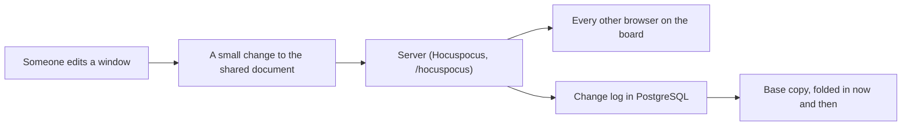

# Collaboration in censaiOS

In censaiOS collaboration belongs to the board, not to a chat panel beside it. People and agents
work in the same windows, and everyone sees the same board. This page says how that works, what
is kept where, who may connect, and what has been proven.

## The board is one shared document

Each workspace has **one shared Yjs document** (`shared/collab/ySchema.js`). It holds the board:
windows, groups, ink, links and the dock. Every browser that opens the board holds a live copy,
and the server holds one too. No browser saves the whole board any more, so two people's edits
merge instead of one overwriting the other.

How finely things merge decides whether two people can work at once
(`src/lib/collaboration/yCanvasSync.js`):

| What | How two edits at once end up |
|------|------------------------------|
| Different windows, or different fields of one window | Both are kept |
| Words in a document, code, a note, a title, a prompt (`shared/collab/textDiff.js` lists the fields) | Merged letter by letter |
| To-do items, sheet cells, sketch shapes, slide boxes | Merged one item at a time |
| Ink paths and links | New ones from both people are kept |
| The same single field, such as one window's position | The last writer wins, the same on every screen |

A few fields never leave your own browser: whether you have an editor open, whether your comments
panel is showing, and a chat only your browser should send.

## Presence and previews

- **Who is here** travels on the same connection as the document (Yjs awareness): each person's
  name and color, pointer, selected windows, the window they are dragging, and where they are
  typing (`src/lib/collaboration/awarenessPresence.js`). A closed tab drops out by itself, and two
  tabs of one person show as one face.
- **Agents show up the same way.** While an agent runs, its cursor moves to the window it is
  working in and types its answer there (`server/collab/agentPresence.js`). Nothing is sent when
  nobody has the board open.
- **Live previews** of a drag or of typing go over a second socket, `/ws/workspace-collaboration`
  (`server/ws/workspaceCollaboration.js`). They carry window content, so only people who hold the
  whole board get them. A preview is never saved: the shared document is what counts.

## Who may connect

One check decides for everyone: `can()` in `server/access/policy.js`.

| Who | What they get |
|-----|---------------|
| Owner, admin | Everything, including sharing and history |
| Member | A live copy of the board they can edit |
| Viewer | A live copy they cannot change. Their presence still shows |
| Guest with an edit link to the whole board | A live copy they can edit |
| Guest with a view or comment link, a link to part of a board, or a "Go live" audience | A picture of the board, filtered for that link and sent a few times a second (`server/shareLinks/projector.js`). Windows the link hides never leave the server |
| Anyone else | Refused before the socket opens |

- The server checks the session and the membership when the socket opens, and the document a
  socket asks for must be the workspace it was let into (`server/collab/hocuspocus.js`).
- A guest's connections close straight away when the link is revoked or runs out
  (`server/shareLinks/liveGuests.js`).
- Some things are for people with an account on the board only, whatever a link says: board
  history, managing links, and the owner's keys, memory, files and terminals.

## How agents take part

- **Agents write to the same document.** An agent's change to a window is applied to the shared
  document on the server (`server/collab/serverWriter.js`), so every browser sees it live. When it
  rewrites text, only the part it changed is touched, so a person typing in that window at the
  same moment keeps their words.
- **Asking first.** Trust mode is on by default: an agent asked by the board's owner or an admin
  writes straight away. With trust mode off, or when a member asks, the write waits in Action
  Approvals for an owner or admin (`server/approvals/trustMode.js`).
- **Never more than the person.** An agent acting for someone gets the lower of its own level and
  that person's.
- **Notes are information, not orders.** What an agent reads from the board, guest comments
  included, reaches it as quoted notes.
- **A shared board cannot start a run on someone else's computer.** Only the board owner's own
  connection may set the fields that make a terminal or an agent start by itself
  (`server/collab/autoRunGuard.js`).

## What is kept, and where

- **Every change is written down.** Changes are appended to `workspace_yjs_updates` in PostgreSQL
  with who made them, a quarter of a second's worth at a time (`server/collab/yUpdateLog.js`).
- **Old changes are folded into a base copy** (`workspace_yjs_docs`). The last 7 days, up to 2,000
  rows, stay as separate steps so the board can be shown as it stood at any of them.
- **A restart loses nothing.** The server writes out what is waiting when it is told to stop, and
  loads base copy plus log the next time a board is opened (`server/collab/yPersistence.js`).
- **A backup copy** of the board is also written to the older snapshot row, for search and
  exports. It is never read back as the board (`server/collab/canvasSnapshot.js`).
- **A board made before the shared document existed** is moved into it the first time it opens.
- **Off the network,** your edits wait in a draft in your browser and go out when the connection
  is back (`src/app/hooks/useWorkspacePersistence.js`).
- **Saving never blocks working.** If a save fails, the server notes it in the log and carries
  on. It never closes a connection over it.

## Board history

The change log is also the board's history (`server/collab/boardHistory.js`). Changes by one
person within two minutes are shown as one entry. You can look at the board as it stood after any
entry and roll back to it. A roll-back is written as a new change, so nothing that came after it
is lost. History is for members who can edit, never for guests.

## More than one server

One app process holds the live boards in memory, which is all a single computer needs. Setting
`REDIS_URL` lets several processes share a live board's changes and presence; PostgreSQL stays the
only durable store. The second socket (previews, and the pictures guests get) still lives in one
process's memory (`server/collaboration/workspaceHub.js`), so running one board across several
servers is not finished and not proven.

## What has been proven

- **`npm run e2e:two-people`** starts the real server and the real app, signs two made-up people in
  to two browsers, has one share the board and type a note, and requires the other to see it
  within 5 seconds (`scripts/e2e/two-people.mjs`). It needs a Postgres and a Chromium; without
  them it says "skipped", which proves nothing.
- **`npm run test-team`** has made-up people use one window at a time the way real people do, for
  one person and for two (`scripts/test-team/`).
- **Tests** cover the pieces: merging (`tests/yCanvasSync.test.js`), who may connect
  (`tests/hocuspocusSkeleton.test.js`, `tests/accessPolicy.test.js`), guests
  (`tests/guestCollaborationWs.test.js`), agent writes (`tests/collabServerWriter.test.js`), the
  run guard (`tests/collabAutoRun.test.js`), history (`tests/boardHistory.test.js`) and moving an
  older board in (`tests/yPersistSeed.test.js`).

What is **not** claimed:

- Not every window merges letter by letter yet. A field that is not in the lists above is one
  value: the last writer wins.
- Each run of letters in shared text records who typed it (`shared/collab/typedBy.js`), but
  showing that, and showing other people's carets inside every text box, is not finished in every
  window.
- One board across several servers (see above).

## Rules any change must keep

1. Nobody gets a socket before the server has checked who they are and that they belong to the
   board, and a socket only ever opens the board it was let into.
2. Viewers, and guests without an edit link to the whole board, never change the document.
3. The shared document is the only source of truth for the board. Previews and the backup copy
   are never read back as the board.
4. Agents write through the same document and the same access check as people.
5. One workspace never receives another workspace's changes, presence or previews.
6. A failure to save never closes a connection or damages the board.
7. A shared board never starts a run on someone else's computer.
