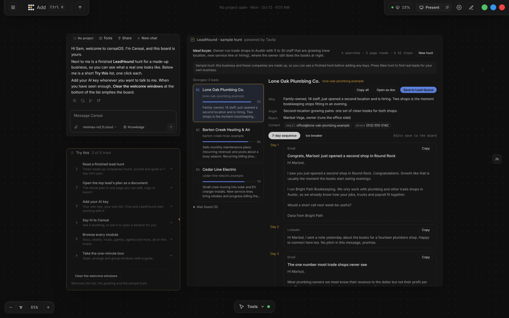
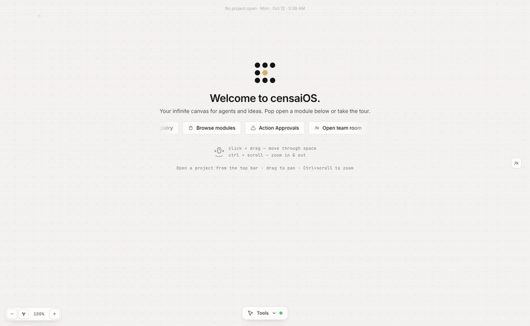
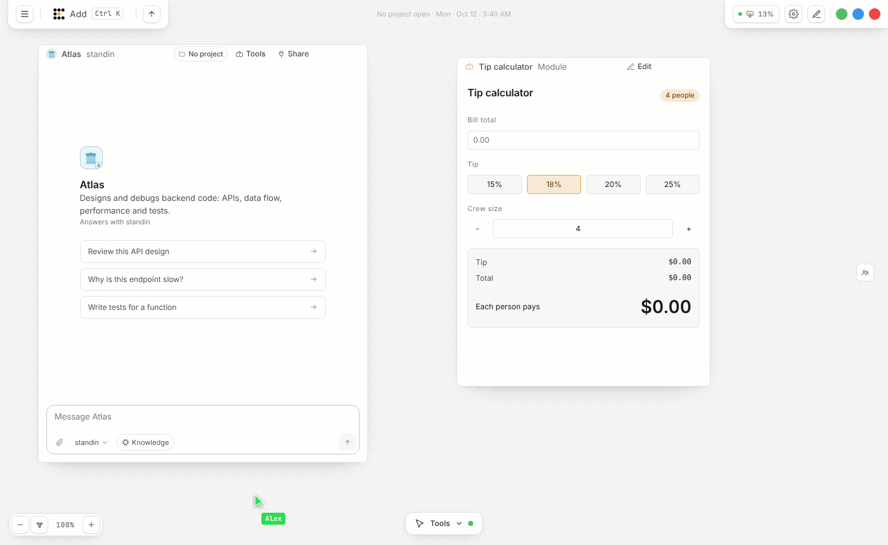
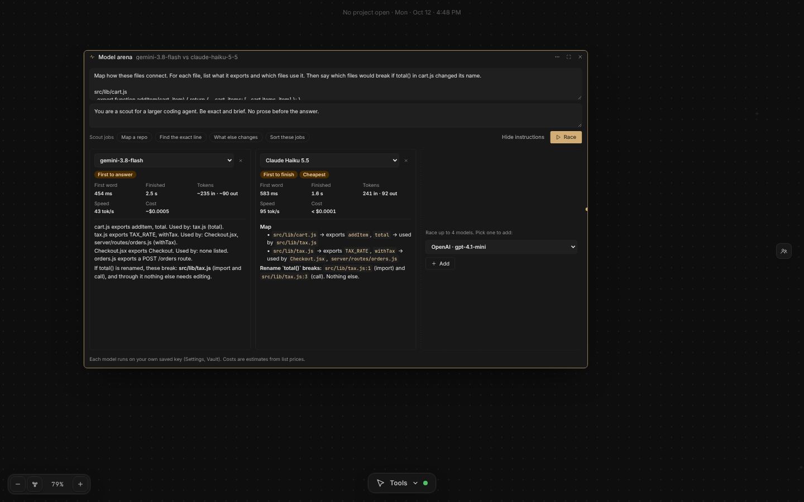

# CensaiOS

**One canvas where your apps and your AI agents live together.** Chat, docs, sheets, a browser,
a terminal, lead hunting, 3D, music and about 70 other modules open as windows on one infinite
board. Agents sit on the same board, use the same windows, and teammates see it all live.
You run it on your own computer with Docker and bring your own AI keys.



[](LICENSE)
[](#run-it-on-your-computer-three-commands)
[](https://github.com/oogalieboogalie/CensaiOS/stargazers)

I made CensaiOS because there's so many tools out there but there's not a singular place to use them all
and none of the major companies are going to make it because they want you locked into their ecosystem.

It's not just for AI users or just for Developers, its also for anyone that works on projects with teams
that wishes there was a way to do it in real time that wasn't a zoom call. It's for people that like to visually
understand things, scribble notes down, and draw literal connections between things.

I'm a small business owner, not a programmer. Every line of this was written with AI coding agents
over about five months, and I check the work by using it. Bug reports and blunt feedback are welcome.

## See it work

An agent working in a module while a teammate watches: you ask Atlas to split a bill, its cursor
moves to the tip calculator on the board, it types the numbers in, and both people see the result.



| Two people on one board | Race up to four AI models side by side |
|---|---|
|  |  |

## Run it on your computer: three commands

You need [Docker Desktop](https://www.docker.com/products/docker-desktop/) installed and running, and about 8 GB of memory. Then:

```bash
git clone https://github.com/oogalieboogalie/CensaiOS.git
cd CensaiOS
docker compose up -d
```

**What you see.** The first start takes a few minutes while Docker builds the app. Then open **<http://localhost:3002>** and you get the censaiOS sign-in screen. Type your name (or leave it blank) and press **Open censaiOS**. The first person to sign in owns this copy. It answers this computer only; to open it from your other computers, turn on **Settings > Open anywhere** and sign them in with a one-time code ([details](SELF_HOSTING_GUIDE.md#who-can-reach-your-copy)).

**Where your AI keys go.** Right after you sign in, a **Connect your AI** screen asks for a key from Claude, OpenAI, Gemini, OpenRouter or another provider. Paste one and press **Save key and open canvas**. Keys are encrypted and stored in this copy's own database, never in a file. You can press **Skip for now** and add or change keys later under **Settings > AI provider keys**. If you run [Ollama](https://ollama.com/) on the same computer, censaiOS can use it with no key at all.

**You don't edit any settings files.** The app makes its own secret passwords on first start and keeps them, sets up its whole database, and wires every part together: the app, the database (PostgreSQL), vector memory (Qdrant) and the Docker helper. Your boards, agents and keys are kept in Docker volumes, so they survive restarts and updates.

**To update** to the newest stable release, from the same folder:

```bash
git pull
docker compose up -d --build
```

**To stop it:** `docker compose down`. Your data stays. (`docker compose down -v` deletes everything, so don't run that unless you mean it.)

**Tweaking it for your business.** Make a file called `.env` next to `docker-compose.yml` with only the lines you want to change. A few useful ones:

| Line | What it changes |
|------|-----------------|
| `CENSAI_APP_MEMORY=6g` | More memory for the app (the default is 4g; the database and vector memory get 1g each) |
| `CENSAI_DOCKER_AI_BASE_URL=...`, `CENSAI_DOCKER_AI_MODEL=...`, `CENSAI_DOCKER_AI_API_KEY=...` | The default AI the app uses when an agent has no key of its own (Ollama on this computer by default) |
| `G_CLIENT_ID=...`, `G_SECRET=...` | Turns on "Continue with Google" sign-in |

Everything else in [`.env.example`](.env.example) is optional. Before you open your copy to other people or the internet, read the [Self-Hosting Guide](SELF_HOSTING_GUIDE.md).

**Looking for a Windows installer?** A desktop app exists, but it is not code-signed yet, so Windows
blocks it with a "Windows protected your PC" warning. A signed installer is on the way. Until then,
the Docker steps above are the supported way to run censaiOS.

## Stable releases and nightly builds

censaiOS ships on two tracks, the way most software does:

| | Stable release | Nightly build |
|---|---|---|
| What it is | A nightly build that passed every public check (tests, build, security scans), with a version number such as 0.4.0 | The newest work, copied here automatically every night |
| How often | Every Sunday | Every night something changed |
| Branch | `main` (what `git clone` and `git pull` give you) | `nightly` |
| Container image | `ghcr.io/oogalieboogalie/censaios:latest` (also `:stable` and `:0.4.0`) | `ghcr.io/oogalieboogalie/censaios:nightly` |
| Use it if | You rely on censaiOS | You want to try what is coming and don't mind rough edges |

To try the nightly build, from your CensaiOS folder:

```bash
git fetch origin nightly
git checkout nightly
docker compose up -d --build
```

`git pull` then keeps you on the nightly builds. To go back to stable: `git checkout main`, then
`docker compose up -d --build`. Your boards, agents and keys stay in their Docker volumes either way.

Every release lists its changes in [CHANGELOG.md](CHANGELOG.md), and the
[Releases page](https://github.com/oogalieboogalie/CensaiOS/releases) has each one's notes and
container tags. Both tracks are made automatically from the development repository; see
[CONTRIBUTING.md](CONTRIBUTING.md) for how changes get here.

## Before you trust this

censaiOS was written with AI coding agents, and it runs AI agents that can use real tools. You should
check it before you run it, and you don't have to take my word for anything. Here is what it does with
your data:

- **Your AI keys** are stored encrypted in this copy's own PostgreSQL database. They are never written
  to a file and never sent anywhere except the AI provider they belong to.
- **Your chats, boards, files and agent memory** stay in Docker volumes on your computer.
- **Outside calls happen only when you use a feature that needs them:** the AI provider you picked,
  web search or lead hunting (Tavily) when you run it, GitHub when you connect a repo, and websites
  you open in the Browser window.
- **No analytics, tracking or usage reporting.** Nothing phones home.
- **Docker access is fenced off.** Only the small `runner` service can use Docker on your computer,
  it has no open port, and it refuses the Docker calls that could take over the machine
  ([`server/runner/dockerOnly.js`](server/runner/dockerOnly.js)). Delete the `runner` service from
  `docker-compose.yml` if you don't want that at all; only the Docker window and Run dev stop working.
- **Only this computer can open it** until you turn on **Settings > Open anywhere**.

**Have your own AI check it.** Paste this into Claude, ChatGPT, Gemini or any coding assistant that
can read GitHub:

```text
Review the open-source project at https://github.com/oogalieboogalie/CensaiOS before I run it
on my computer with Docker. Tell me plainly:
1. Does it send my data, files, or API keys anywhere other than the AI provider I choose?
   Look for analytics, telemetry, or hidden network calls in server/ and src/.
2. What does docker-compose.yml give the containers access to on my computer
   (volumes, ports, the Docker socket), and is any of it dangerous?
3. Are there signs of malicious code: obfuscated strings, install scripts that download and
   run things, eval of remote code, or hardcoded IP addresses?
4. How are my API keys stored?
Quote the file and line for anything you flag, and say what you could not check.
```

Found a security problem? Please report it privately, as described in [SECURITY.md](SECURITY.md).

Here's the shape of it: CensaiOS is a multiplayer canvas. Instead of one person staring at one
chat box, a workspace holds the people, the agents, and the work itself — documents, terminals,
tasks, files — arranged in space so you can see what the hell is going on.

## The core idea

A chat box forgets. A canvas doesn't. Censai is built around the **shared workspace** as the unit
that matters:

- **People share a canvas**, not a screen recording. Presence, window positions, and durable canvas
  changes belong to the workspace.
- **Agents occupy the workspace too.** They can inspect authorized context, use equipped tools, run
  in the background, and—after the required approval—write into visible work surfaces.
- **The canvas preserves context.** Documents, terminals, tasks, files, chats, browsers, agents, and
  their relationships stay spatially arranged instead of disappearing into a transcript.
- **You own the runtime.** Run it on your workstation, home server, or private server with Docker.

## Multiplayer collaboration

The multiplayer beta covers the important slice end to end: an owner invites a workspace member,
both see live presence and window movement, durable changes are revision-checked into PostgreSQL
and broadcast to everyone, and an equipped agent can request approval, write into a canvas window,
and publish the result to both people. Reconnecting restores the authoritative revision;
non-members are denied.

Document and code windows have character-by-character collaborative text editing (Yjs), so a
teammate sees each keystroke as you type. Other windows share their content when you save.
[COLLABORATION.md](COLLABORATION.md) explains how the pieces fit together.

## What's new

[CHANGELOG.md](CHANGELOG.md) lists every change in each stable release, and at the top, what the
nightly builds have that no stable release has yet. New work is built and passes the automated
tests before it lands, but expect rough edges in anything that is only in the nightly builds.

## What else is inside

### Infinite canvas

- Pan, zoom, draw, group, resize, and arrange work across a persistent spatial surface.
- Connect agents to windows and organize related work into visual stations.
- Use 70+ built-in window types, including documents, code, terminals, files, tasks,
  schedules, chats, browsers, images, media, agent design, and operational tools.
- Scaffold a new window with `npm run window:new` and validate it with `npm run window:validate`.

### Persistent agents

- Create agents with their own identity, role, model route, tools, and workspace-scoped permissions.
- Store memories, knowledge-graph facts, and AES-256-GCM encrypted private journals.
- Run with Ollama locally or use OpenAI-compatible, OpenRouter, Gemini, and other configured providers.
- Queue background tasks and schedules that continue after the browser closes.
- Give different agents different tools instead of exposing every capability to every model.

### Self-hosted control

- PostgreSQL is the durable authority for workspace and agent state.
- Qdrant provides optional semantic recall and degrades gracefully when unavailable.
- Risky execution capabilities can be kept behind the optional runner boundary.
- Every public export is scanned for leaked secrets and checked by malicious-code tripwires
  before it lands here.

## Documentation

- [Collaboration model](COLLABORATION.md)
- [Self-hosting guide](SELF_HOSTING_GUIDE.md)
- [Architecture](ARCHITECTURE.md)
- [Window integration specification](docs/WINDOW_INTEGRATION_SPEC.md)
- [Contributing](CONTRIBUTING.md)
- [Security policy](SECURITY.md)

## Project status

CensaiOS is an active, founder-led beta. The canvas, agents, memory, tools, self-hosting, and
multiplayer board are real and used daily. Running one copy across several servers is still
engineering work, and some modules are rougher than others. This README
deliberately claims less than the ambition.

## License

[Apache License 2.0](LICENSE). You may run, modify, and self-host Censai,
including for business use.
